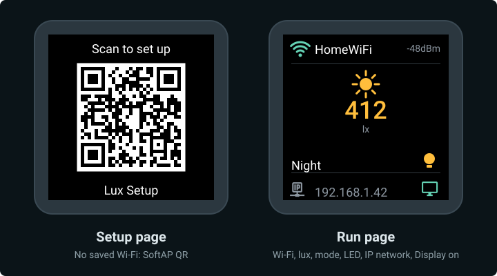

# Display

The **240×240** ST7789 needs a SPI bus, a backlight, fonts, a QR payload, and two pages. Home Assistant gets a **Display** switch to turn the backlight on or off.



*Mock-up from the display code: SoftAP QR, then Wi‑Fi status, live lux, mode, LED state, IP, and a display-on cue. Run-page values are samples.*

## Pins

| Signal | GPIO | Set in | Wired in |
|--------|------|--------|----------|
| SCK / SCL | **1** | `spi` | [Display](../03-wire/display.md) |
| MOSI / SDA | **0** | `spi` | same |
| CS | **10** | `display` | same |
| DC | **3** | `display` | same |
| RST | **7** | `display` | same |
| BL | **21** | `output` | same |

Silk on the module may say `SCL` or `SCK` for the clock — same net.

## SPI bus

```yaml
spi:
  clk_pin: GPIO1
  mosi_pin: GPIO0
```

The display only receives data, so the bus has no MISO pin. CS, DC and RST are set on the `display` block.

## Backlight and Display switch

```yaml
output:
  - platform: ledc
    id: backlight_pwm
    pin: GPIO21

light:
  - platform: monochromatic
    id: backlight
    output: backlight_pwm
    internal: true
    restore_mode: ALWAYS_OFF

switch:
  - platform: template
    name: Display
    id: tft_enable
    icon: mdi:monitor
    optimistic: true
    restore_mode: RESTORE_DEFAULT_ON
    turn_on_action:
      - light.turn_on:
          id: backlight
          brightness: 100%
    turn_off_action:
      - light.turn_off: backlight
```

| Key | What it does |
|-----|--------------|
| `ledc` output | PWM on GPIO21 for the backlight |
| `light` (internal) | Drives brightness; not shown in Home Assistant |
| `switch` **Display** | On/off in Home Assistant — turns the TFT backlight fully on or off |
| `RESTORE_DEFAULT_ON` | Remembers the last Display state; defaults to on |

Readings keep updating while the backlight is off.

## Fonts and QR

```yaml
font:
  - file: "gfonts://Roboto@500"
    id: font_big
    size: 36
  - file: "gfonts://Roboto"
    id: font_text
    size: 18
  - file: "gfonts://Roboto"
    id: font_small
    size: 14
  - file: "https://raw.githubusercontent.com/Templarian/MaterialDesign-Webfont/master/fonts/materialdesignicons-webfont.ttf"
    id: font_mdi
    size: 26
    glyphs:
      - "\U000F0432"  # qrcode
      - "\U000F0C90"  # ip-network-outline
      - "\U000F05AA"  # wifi-off
      - "\U000F091F"  # wifi-strength-1
      - "\U000F0922"  # wifi-strength-2
      - "\U000F0925"  # wifi-strength-3
      - "\U000F0928"  # wifi-strength-4
      - "\U000F0379"  # monitor
      - "\U000F06E8"  # lightbulb-on
      - "\U000F0336"  # lightbulb-outline
  - file: "https://raw.githubusercontent.com/Templarian/MaterialDesign-Webfont/master/fonts/materialdesignicons-webfont.ttf"
    id: font_mdi_lg
    size: 40
    glyphs:
      - "\U000F05A8"  # white-balance-sunny

qr_code:
  - id: setup_qr
    value: "WIFI:S:${ap_ssid};T:WPA;P:${ap_password};;"
```

| Piece | Role |
|-------|------|
| `font_big` (36) | The lux value |
| `font_text` (18) | Mode, SSID and IP |
| `font_small` (14) | `lx` and the dBm reading |
| `font_mdi` (26) | Status row, LED bulb, monitor, QR |
| `font_mdi_lg` (40) | Large sun above the lux reading |
| `setup_qr` | Standard Wi‑Fi QR from the same `ap_ssid` / `ap_password` as the hotspot |

Only the `glyphs` listed are embedded, which keeps the firmware small. Roboto and the icon font are downloaded at compile time (needs internet once), then baked into the firmware.

## Pages

`page_setup` draws the SoftAP QR. `page_run` is the connected dashboard — Wi‑Fi strength, live lux, mode label, LED on/off, IP, and a monitor icon for the **Display** switch. Full lambdas live in [`firmware/lux.yaml`](https://github.com/jajera/esp32-c3-ha-lux/blob/main/firmware/lux.yaml).

| Setting | What it does |
|---------|--------------|
| `update_interval: 2s` | Redraw every two seconds |
| `invert_colors: true` | Matches this 240×240 module — flip if colours look wrong |
| First page in the list | Default is readings; boot logic shows QR only when no home Wi‑Fi is saved |
| `wifi_info` text sensors | Feed SSID and IP into `page_run` |
| `wifi_signal` | Feeds dBm and picks the strength icon |

| Page | Draws |
|------|-------|
| `page_setup` | QR icon, "Scan to set up", SoftAP QR, hotspot name (`Lux Setup`) |
| `page_run` | Wi‑Fi strength + SSID + dBm; sun icon + lux + `lx`; mode (`Off` / `Schedule` / `Night`) + LED bulb; IP + display-on icon |

The monitor icon is always drawn. It does not change when you switch **Display** off — the backlight is off by then and the whole screen is dark.

[Wi‑Fi setup](wifi.md) chooses the page at boot and on connect / disconnect (QR only when unprovisioned).

When you change the run-page layout, keep this page and the mock-up in sync.

**Next:** [Factory reset](reset.md)
