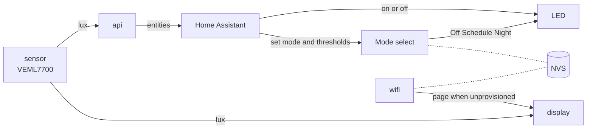

# 1. Walk through the code

The firmware is one [ESPHome](https://esphome.io) file: [`firmware/lux.yaml`](https://github.com/jajera/esp32-c3-ha-lux/blob/main/firmware/lux.yaml). You describe the hardware and behaviour in YAML; ESPHome turns that into firmware.

You don't need to memorise the file. The point is to know which block to open when you want to change something.

## How the pieces connect

The display defaults to readings. The QR setup page appears only when no home Wi‑Fi is saved yet (first boot or after factory reset). A short drop keeps the readings page and switches the header to the disconnected Wi‑Fi glyph. The dotted lines are where the chip stores home Wi‑Fi and Mode / schedule / night settings (NVS), never this file.

Schedule and Night run on the device from those saved values. Schedule also needs a valid clock (SNTP when online).

## The blocks

- :lucide-cpu: **[ESP32](board.md)**

    `substitutions` `esphome` `esp32` `logger` `time`

- :brands-home-assistant:{ .lg .middle } **[Home Assistant](home-assistant.md)**

    `api` `ota` `dashboard_import`

- :lucide-wifi: **[Wi‑Fi setup](wifi.md)**

    `wifi` `captive_portal` (+ Improv in YAML, not walked through)

- :lucide-sun: **[Lux and LED](lux-led.md)**

    `i2c` `sensor` `output` `light`

- :lucide-cog: **[Modes](modes.md)**

    `select` `number` `script` `interval`

- :lucide-monitor: **[Display](display.md)**

    `spi` `output` `light` `switch` `font` `qr_code` `display`

- :lucide-rotate-ccw: **[Factory reset](reset.md)**

    `button` `binary_sensor`

## Where to change things

| If you want to change… | Open |
|------------------------|------|
| Setup hotspot name or password | [ESP32](board.md) → `substitutions` |
| Timezone for Schedule | [ESP32](board.md) → `timezone` |
| How often lux is read | [Lux and LED](lux-led.md) → `update_interval` |
| Default schedule or night thresholds | [Modes](modes.md) → `datetime` / `number` |
| Screen colours, layout or text | [Display](display.md) → `pages` |
| Which pins are used | [Lux and LED](lux-led.md) / [Display](display.md) (same pins as [Wire](../03-wire/index.md)) |
| Reset hold time | [Factory reset](reset.md) → `binary_sensor` |

**Next:** [ESP32](board.md)
