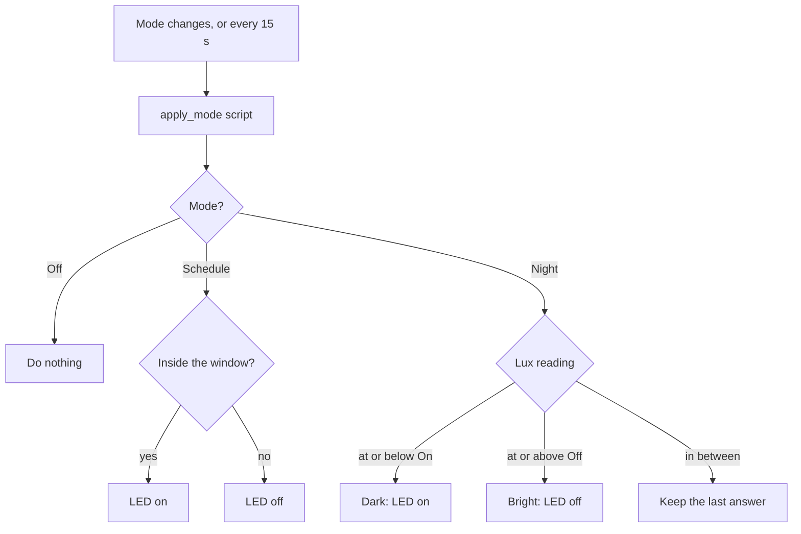

# Modes

Three modes, set from Home Assistant and stored on the ESP32. Default is **Off**.

| Mode | Behaviour |
|------|-----------|
| **Off** | Automatic mechanisms off. The LED follows Home Assistant on/off only |
| **Schedule** | Daily start/end window on the device clock (can cross midnight) |
| **Night** | Lux hysteresis: on at or below **Night On Lux**, off at or above **Night Off Lux** |



## Mode select

```yaml
select:
  - platform: template
    name: Mode
    id: control_mode
    icon: mdi:cog
    optimistic: true
    restore_value: true
    initial_option: "Off"
    options:
      - "Off"
      - "Schedule"
      - "Night"
    on_value:
      then:
        - script.execute: apply_mode
```

| Key | What it does |
|-----|--------------|
| `optimistic: true` | Takes the value Home Assistant sends and reports it back |
| `restore_value: true` | Saves the choice in NVS across reboots |
| `initial_option` | First-boot default: **Off** |
| `on_value` | Runs `apply_mode` immediately when the mode changes |

## Schedule and Night settings

Schedule uses two Home Assistant **time** entities so hour and minute commit together (avoids applying a half-edited window). Night uses two lux `number` entities. All are `optimistic` with `restore_value: true`, so Home Assistant sets them and the device keeps the last value after reboot and while offline.

```yaml
datetime:
  - platform: template
    type: time
    name: Schedule Start
    id: sched_start
    entity_category: config
    icon: mdi:clock-start
    optimistic: true
    restore_value: true
    initial_value: "18:00:00"

  - platform: template
    type: time
    name: Schedule End
    id: sched_end
    entity_category: config
    icon: mdi:clock-end
    optimistic: true
    restore_value: true
    initial_value: "23:00:00"

number:
  - platform: template
    name: Night On Lux
    id: night_on_lx
    entity_category: config
    unit_of_measurement: lx
    min_value: 0
    max_value: 1000
    step: 1
    initial_value: 20
    optimistic: true
    restore_value: true
    mode: box
```

**Night Off Lux** uses the same `number` pattern with default **40** lx (range 0–2000).

| Entity | Type | First-boot default |
|--------|------|--------------------|
| Schedule Start | time | 18:00 |
| Schedule End | time | 23:00 |
| Night On Lux | number | 20 lx |
| Night Off Lux | number | 40 lx |

Out of the box, Schedule runs **18:00–23:00**, and Night turns on at **20 lx** and off at **40 lx**. `entity_category: config` groups them under **Configuration** on the device page in Home Assistant (expand that section if you only see Mode).

## Mode Label

```yaml
text_sensor:
  - platform: template
    name: Mode Label
    id: mode_label
    entity_category: diagnostic
    update_interval: 2s
    lambda: |-
      if (!id(control_mode).has_state())
        return {"Off"};
      return {id(control_mode).current_option().str()};
```

Read-only diagnostic text that repeats the current mode name. Useful on a dashboard card; falls back to `Off` until the select has a value. The TFT also draws the mode name from `control_mode` directly.

## Apply loop

```yaml
interval:
  - interval: 15s
    then:
      - script.execute: apply_mode
```

`apply_mode` runs on mode change and every 15 seconds. It only toggles the LED when the answer differs from the current state.

- **Off:** does nothing to the LED.
- **Schedule:** compares local time to the window. Equal start and end means an empty window (LED off). Start later than end means the window crosses midnight (e.g. 22:00–06:00). Needs a valid clock — after a cold boot with no network it waits for SNTP.
- **Night:** keeps an on-device flag `night_is_dark`. At or below **Night On Lux** the flag turns on; at or above **Night Off Lux** it turns off; in between it keeps the last value (hysteresis). Keep On below Off. The flag is not saved across reboot.

The screen always shows the current mode name. See [Lux and LED](lux-led.md) for how HA overrides interact with Schedule and Night.

**Next:** [Display](display.md)
