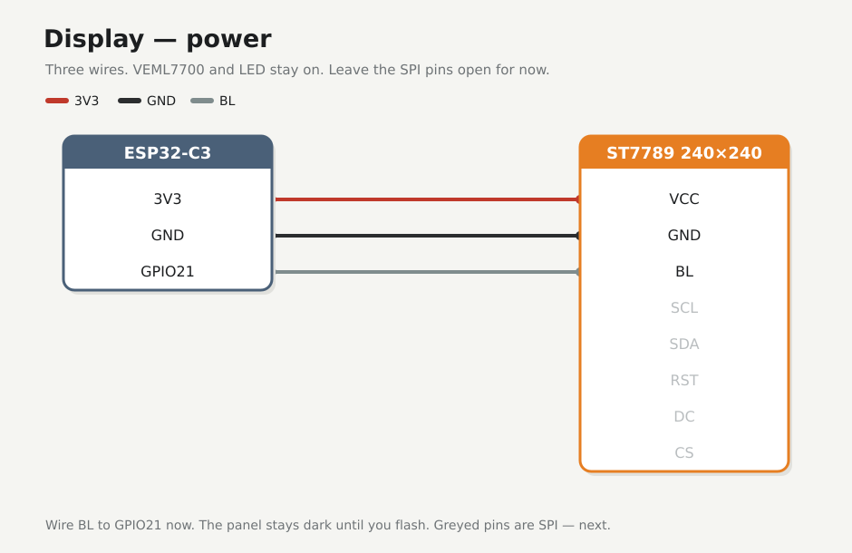
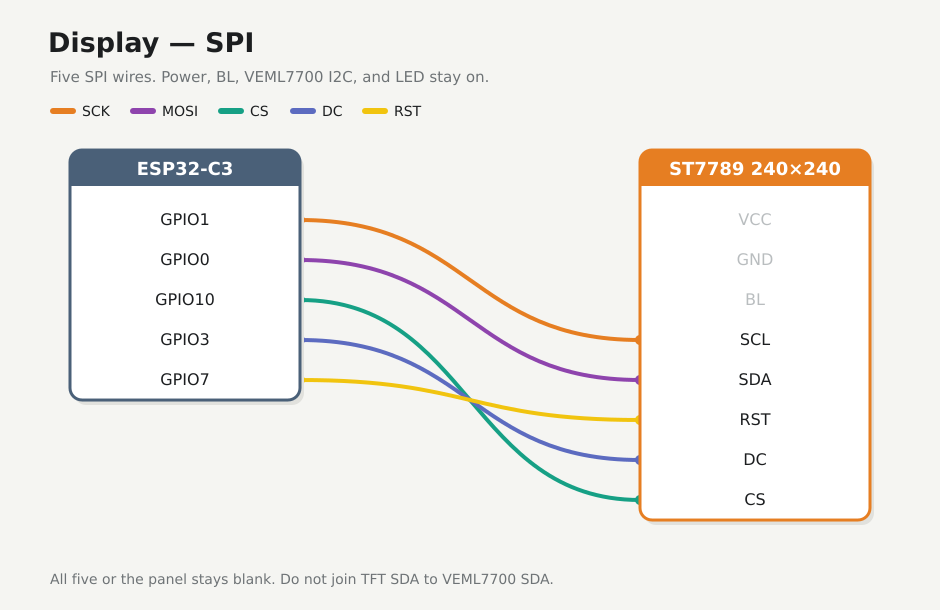

# Display (ST7789 240×240)

A square **240×240** ST7789 SPI module with an 8-pin header. Power first, then the five SPI wires.

!!! note "Before you start"
    [Checkpoint 4](led.md) passed. USB unplugged while you seat jumpers. The VEML7700 power and I2C wires, and the LED, stay on.

!!! warning
    Power from **3V3 only**. The display's `SDA` must never share a wire with the VEML7700's `SDA`.

## Pin names

Match your module's printed labels. Clock may read **SCL** or **SCK** (same net). **SDA** here is SPI MOSI, not I2C.

| Pin | Meaning | ESP32-C3 pin |
|-----|---------|--------------|
| `SCL` / `SCK` | SPI clock | **GPIO1** |
| `SDA` | SPI MOSI. **Not** I2C | **GPIO0** |
| `RST` | Reset (sometimes `RES`) | **GPIO7** |
| `DC` | Data or command | **GPIO3** |
| `CS` | Chip select | **GPIO10** |
| `BL` | Backlight control | **GPIO21** |

## 1. Power

| | From | To |
|---|------|----|
| :lucide-plus: | `+` rail (3V3) | Display **VCC** |
| :lucide-minus: | `−` rail (GND) | Display **GND** |
| :lucide-cable: | **GPIO21** | Display **BL** |

Leave the SPI pins open for now. Plug in USB and check that the module is cool, with about 3.3 V on VCC if you have a meter. Unplug before adding SPI.

!!! note "BL → GPIO21"
    Firmware will PWM this pin later. Wire it now; do not expect the panel to light on this page.

## 2. SPI

| | ESP32-C3 | Display |
|---|----------|---------|
| :lucide-clock: | **GPIO1** | **SCL** (or **SCK**) |
| :lucide-arrow-right: | **GPIO0** | **SDA** (MOSI) |
| :lucide-pointer: | **GPIO10** | **CS** |
| :lucide-split: | **GPIO3** | **DC** |
| :lucide-rotate-ccw: | **GPIO7** | **RST** |

All five jumpers. Leave the panel dark until you [flash](../04-flash-esp32.md).

## If it fails

| Symptom | Fix |
|---------|-----|
| Module warm | Unplug. Check for 5V on VCC or a shorted pin |
| Meter doesn't read about 3.3 V on VCC | Confirm the ESP32 still feeds the `+` rail ([checkpoint 2](esp32.md)) |
| Panel stays blank after flash | Come back here. Check all five SPI wires, that BL is on GPIO21, and that display SDA is not joined to VEML7700 SDA |

## Checkpoint 5

- [ ] Display VCC and GND are on the 3V3 and GND rails, and BL is on GPIO21
- [ ] The module is cool with USB plugged in
- [ ] All five SPI wires are in: GPIO1, 0, 10, 3, 7 to SCL, SDA, CS, DC, RST
- [ ] Display SDA is not joined to VEML7700 SDA

**Stop here until every box is ticked.**

**Next:** [Validate](validate.md)
