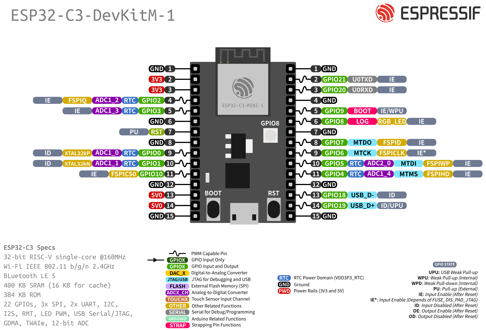

# ESP32

Put the ESP32-C3 on the breadboard and feed the `+` and `−` rails from it. Later steps take power from those rails.

!!! note "Before you start"
    [Checkpoint 1](breadboard.md) passed. USB unplugged while you seat jumpers.

Match pins by **silk label**, not by position. This tutorial uses an **ESP32-C3** DevKit: one USB port for power and serial, **BOOT** on **GPIO9**. Some boards use a USB-to-UART chip; others (including the board used for these checks) use the chip's built-in USB Serial/JTAG.



*ESP32-C3-DevKitM-1 pin layout (Espressif) — use it to find **3V3**, **GND**, **BOOT** (GPIO9), and GPIO numbers by silk. Your board's USB connector shape may differ.*

## Wires

| | From ESP32 | To breadboard |
|---|------------|---------------|
| :lucide-plus: | **3V3** | `+` rail |
| :lucide-minus: | **GND** | `−` rail |

!!! warning "Bridge the rail halves"
    Many breadboards split each power rail in the middle — and each long edge has its own `+` / `−` pair. On the edge you use, seat a short jumper across the gap on **both** `+` and `−`, or modules on the far half get no 3V3/GND. See [Breadboard](breadboard.md).

!!! warning
    Don't power the sensor or display from **5V** or **VIN**.

## Leave these pins free

| | Pin | Why |
|---|-----|-----|
| :lucide-rotate-ccw: | **GPIO9** | The **BOOT** button, used for the factory reset |
| :lucide-usb: | GPIO18 / 19 | USB D− / D+ on the chip (Serial/JTAG) |
| :lucide-triangle-alert: | GPIO2 / 8 | Strapping pins (GPIO8 also drives the on-board RGB LED) |

Seat the board across the centre trench so each pin has its own breadboard row. Leave space beside it for the VEML7700, LED, and display.

## Check

Plug a USB **data** cable into the board's USB port, then run:

<div class="run" markdown>

```bash
lsusb | grep -iE '303a|Espressif|10c4|cp21|1a86|QinHeng|Silicon'
ls -l /dev/ttyACM0 /dev/ttyUSB0 2>/dev/null
```

```text {.no-copy}
Bus 001 Device 024: ID 303a:1001 Espressif USB JTAG/serial debug unit
crw-rw-rw- 1 root dialout 166, 0 Nov 11 23:23 /dev/ttyACM0
```

</div>

This capture is from a board that uses Espressif's built-in USB Serial/JTAG (`303a`). A DevKitM-1 with a CP210x bridge instead shows Silicon Labs (`10c4`) and may appear as `/dev/ttyUSB0`. Either is fine — you need a serial device for flash and logs.

Nothing on the board should get warm. Unplug before the next step.

## If it fails

| Symptom | Fix |
|---------|-----|
| No `/dev/ttyACM*` or `/dev/ttyUSB*` | Try another **data** cable (charge-only cables never show a port) |
| Board warm | Unplug. 3V3 and GND may be swapped or shorted on the rail |
| A meter on the `+` rail reads 5 V instead of about 3.3 V | The rail is fed from the wrong pin. Move the wire to **3V3** |
| Only one half of the rail has ~3.3 V | Mid-rail gap. Bridge `+` and bridge `−` ([Breadboard](breadboard.md)) |

## Checkpoint 2

- [ ] Only **3V3** to `+` and **GND** to `−` from the ESP32 (no sensor, LED, or display wires yet)
- [ ] Rail gaps bridged, if your board has them
- [ ] The board shows up in `lsusb` and as a serial device
- [ ] The board stays cool

**Stop here until every box is ticked.**

<small>Pin layout: Espressif [ESP32-C3-DevKitM-1](https://docs.espressif.com/projects/esp-dev-kits/en/latest/esp32c3/esp32-c3-devkitm-1/user_guide.html) documentation.</small>

**Next:** [VEML7700](veml7700.md)
