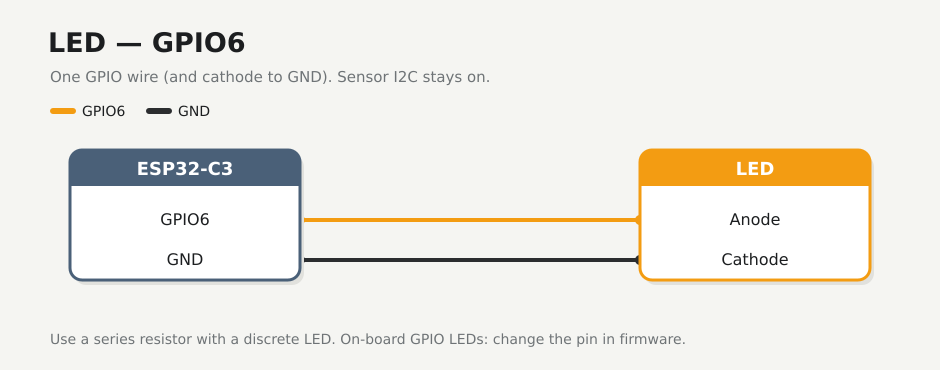

# LED

A binary LED on **GPIO6** — on or off only, no brightness. Power and I2C for the VEML7700 stay as they were.

!!! note "Before you start"
    [Checkpoint 3](veml7700.md) passed. USB unplugged while you seat jumpers.

## Wire

| | From | To |
|---|------|----|
| :lucide-lightbulb: | ESP32-C3 **GPIO6** | LED **anode** (long leg), through a series resistor if the LED is discrete |
| :lucide-minus: | `−` rail (GND) | LED **cathode** (short leg) |

A typical discrete LED needs something like **220 Ω–1 kΩ** in series with the anode so GPIO6 is not shorted to GND through the diode.

!!! tip "On-board LED instead?"
    Some DevKits already have a usable GPIO LED. If you prefer that, change the pin in `firmware/lux.yaml` and keep this page and [Validate](validate.md) in sync. Leave GPIO6 free if you do.

Do not tie the LED to **3V3** or **5V** — the firmware drives it from GPIO6 only.

## Check

Plug in USB briefly. The LED stays off until you flash and turn it on from Home Assistant (or Schedule / Night). Nothing should get warm. Unplug before the display step.

## If it fails

| Symptom | Fix |
|---------|-----|
| LED or board warm | Unplug. Check the cathode is on GND, not 3V3, and that a series resistor is in place for a discrete LED |
| LED never lights after flash | Confirm anode → GPIO6 and cathode → GND; try swapping polarity once |
| GPIO6 shorted to 3V3 | Rewire — that path can damage the pin |

## Checkpoint 4

- [ ] Discrete LED: GPIO6 → resistor → anode, cathode → GND (or your chosen on-board GPIO LED is documented in the YAML)
- [ ] No wire from the LED to 3V3 or 5V
- [ ] VEML7700 power and I2C still seated
- [ ] No display wires yet

**Stop here until every box is ticked.**

**Next:** [Display](display.md)
