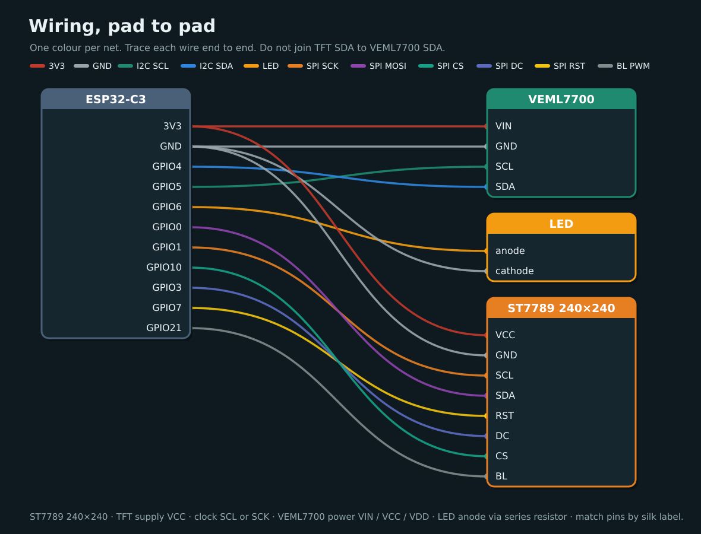

# Validate

Walk the full pin map and confirm USB still works. Do not expect the display to light or the VEML7700 to report values here — that comes after you [flash](../04-flash-esp32.md).

!!! note "Before you start"
    [Checkpoint 5](display.md) passed. Everything from the earlier steps stays wired.



## The full map

| ESP32-C3 | VEML7700 | LED | Display (ST7789) |
|----------|----------|-----|------------------|
| **3V3** | VIN / VCC | | VCC |
| **GND** | GND | cathode | GND |
| **GPIO4** | SDA | | |
| **GPIO5** | SCL | | |
| **GPIO6** | | anode (via R) | |
| **GPIO0** | | | SDA (MOSI) |
| **GPIO1** | | | SCL / SCK |
| **GPIO10** | | | CS |
| **GPIO3** | | | DC |
| **GPIO7** | | | RST |
| **GPIO21** | | | BL |

## Rules

- **3V3 only** for sensor and display logic.
- Do not join TFT SDA to VEML7700 SDA.
- Leave **GPIO9** (BOOT) free for factory reset.
- Avoid **GPIO18 / GPIO19** (USB D− / D+).
- Match pins by **silk label**, not by position on the header.

## Check

| | Check | What to look for |
|---|-------|------------------|
| :lucide-list-checks: | Walk the map | Every row above has a jumper on the matching pin label |
| :lucide-split: | Two separate buses | VEML7700 uses GPIO4 and 5. Display SDA/SCL use GPIO0 and 1 and never share a wire with them |
| :lucide-zap: | 3V3 only | No sensor or display pin is on 5V or VIN |
| :lucide-hand: | Cool | After a few seconds on USB, lightly touch the VEML7700, LED, and display. If anything is warm, unplug and recheck power and ground |
| :lucide-usb: | USB | Data cable in the board's USB port. Run the commands below |

<div class="run" markdown>

```bash
lsusb | grep -iE '303a|Espressif|10c4|cp21|1a86|QinHeng|Silicon'
ls -l /dev/ttyACM0 /dev/ttyUSB0 2>/dev/null
```

```text {.no-copy}
Bus 001 Device 024: ID 303a:1001 Espressif USB JTAG/serial debug unit
crw-rw-rw- 1 root dialout 166, 0 Nov 11 23:23 /dev/ttyACM0
```

</div>

Expect either Espressif's built-in USB Serial/JTAG (`303a`) or a bridge such as CP210x (`10c4`) / QinHeng (`1a86`), and a port such as `/dev/ttyACM0` or `/dev/ttyUSB0`. The panel may stay dark. I2C at `0x10`, the LED, backlight, and the setup QR are checked on [Flash](../04-flash-esp32.md).

## If it fails

| Symptom | Likely fix |
|---------|------------|
| No serial port | Use a **data** cable (charge-only cables never show a port). USB group setup is in [Flash](../04-flash-esp32.md) |
| Something warm | Unplug. Start at 3V3 and GND, then the last wires you added |
| The map doesn't match | One jumper is on the wrong pin. Walk the table row by row |
| Display SDA tied to VEML7700 SDA | Separate the buses — TFT SDA is SPI MOSI on GPIO0 |

## Checkpoint 6

- [ ] The full map matches the table above
- [ ] The I2C and SPI buses are not crossed
- [ ] The board shows up on USB (`lsusb` and a serial device)
- [ ] Sensor, LED wiring, and display stay cool

**Stop here until every box is ticked.**

**Next:** [Flash the ESP32](../04-flash-esp32.md)
