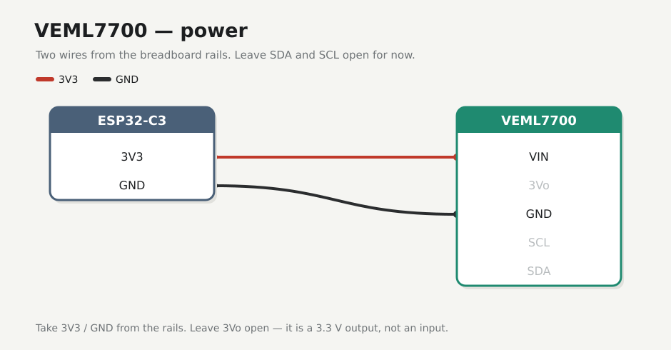
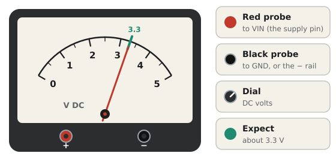
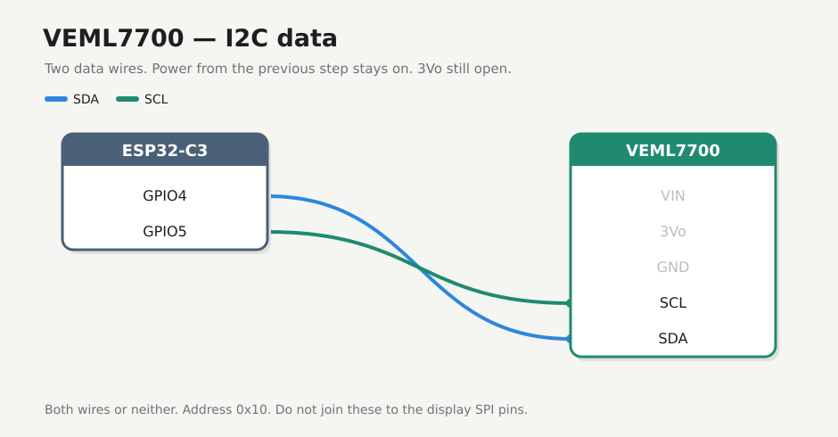

# VEML7700

Ambient light over I2C, at address **0x10**. Power first, then the two data wires.

!!! note "Before you start"
    [Checkpoint 2](esp32.md) passed. USB unplugged while you seat jumpers.

!!! warning
    Power from **3V3 only**. After wiring, check for heat and, if you have a meter, about 3.3 V on the supply pin.

The power pin may be printed **VIN**, **VCC** or **VDD**. They all go to the 3V3 rail.

Many breakouts also have **3Vo** (or **3V3**). That is a **3.3 V output** from the on-board regulator, not a power input. Leave it unconnected in this tutorial.

## 1. Power

| | From | To |
|---|------|----|
| :lucide-plus: | `+` rail (3V3) | VEML7700 **VIN** / **VCC** / **VDD** |
| :lucide-minus: | `−` rail (GND) | VEML7700 **GND** |
| :lucide-circle-off: | — | **3Vo** — leave open |

Leave **SDA**, **SCL**, and **3Vo** open for now. Plug in USB and check that the module is cool. If you have a meter, expect about **3.3 V** on **VIN** (optional):

{ .meter }

Unplug before adding the data wires.

## 2. I2C

| | ESP32-C3 | VEML7700 |
|---|----------|----------|
| :lucide-arrow-right-left: | **GPIO4** | **SDA** |
| :lucide-clock: | **GPIO5** | **SCL** |

Both wires or neither. One alone will fail the later scan at `0x10`.

!!! warning "Keep the buses apart"
    Do **not** join these to the display's `SDA` and `SCL` pins. Those are SPI.

## If it fails

| Symptom | Fix |
|---------|-----|
| Module warm | Unplug. Check that VIN isn't on 5V, GND is on the `−` rail, and you didn't feed power into **3Vo** |
| Meter doesn't read about 3.3 V | Confirm the ESP32 still feeds the `+` rail ([checkpoint 2](esp32.md)). If the sensor is on the other half of the board, bridge the mid-rail gaps ([Breadboard](breadboard.md)) |
| Flashing later shows no `0x10` | Come back here. Check SDA and SCL aren't swapped, reseat both data jumpers, and shorten the wires |

## Checkpoint 3

- [ ] VEML7700 **VIN** is on the 3V3 rail and **GND** on the GND rail; **3Vo** has no wire
- [ ] GPIO4 to SDA and GPIO5 to SCL, both seated
- [ ] The module stays cool with USB plugged in (and about 3.3 V on VIN, if metered)
- [ ] No wires on the LED or display yet

**Stop here until every box is ticked.**

**Next:** [LED](led.md)
