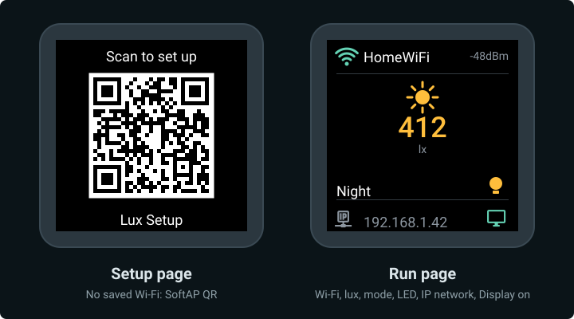

# 5. Configure and test

Get the device onto your Wi‑Fi, add it to Home Assistant, and check that modes, lux, the LED, and the reset work.

## What the screen shows



*TFT layout from the firmware. Left: SoftAP QR (**Lux Setup**). Right: run page — Wi‑Fi status, live lux, mode, LED state, IP, Display-on cue. Run-page values are samples.*

## Connect to your Wi‑Fi {#connect-wifi}

While the device has no saved network, the screen shows a QR code and the device broadcasts its own hotspot:

| Setting | Value |
|---------|-------|
| Hotspot name | `Lux Setup` |
| Hotspot password | `setup1234` |

### From your phone (QR code)

1. Point your phone camera at the QR code on the screen and tap the Wi‑Fi prompt to join **Lux Setup**.
2. A setup page opens automatically. If it doesn't, open `http://192.168.4.1` in the browser.
3. Pick your home SSID, enter the password, tap **Save**.
4. Wait for the device to join. SoftAP turns off and the screen switches to the run page (Wi‑Fi status, lux, mode, LED, IP).

After a successful join, the serial log looks like this (SSID and IP will differ on your network):

<div class="run" markdown>

```bash
.venv/bin/esphome logs firmware/lux.yaml --device /dev/ttyACM0
```

```text {.no-copy}
…
[D][wifi:708]: Loaded settings: …
[I][wifi:1732]: Connected
[D][wifi:1127]: Disabling AP
[C][wifi:1392]:   IP Address: …
[C][wifi:1403]:   SSID: '…'
  Hostname: 'esp32-c3-ha-lux-…'
…
```

</div>

!!! note "Other onboarding (not in this guide)"
    The firmware also enables Improv over BLE and serial. This tutorial only documents the QR + captive portal path above.

## Add it to Home Assistant

Once the device is on your network, Home Assistant normally finds it by itself:

1. Go to **Settings → Devices & services**. A discovered **ESPHome** device appears at the top.
2. Click **Add** and confirm. Home Assistant sets the device's encryption key as it adds it.
3. Open the device page. You should see **Illuminance**, **LED**, **Mode**, **Display**, **Factory Reset**, and **Restart**, plus Wi‑Fi signal and uptime under Diagnostic. Under **Configuration**: **Schedule Start**, **Schedule End** (time pickers), **Night On Lux**, and **Night Off Lux**.

If nothing is discovered, add the **ESPHome** integration manually:

| Field | Value |
|-------|-------|
| Host | the device IP (from the log, the run page, or your router) |
| Port | **6053** |

When Home Assistant is connected, the serial log shows an API client (your IP will differ):

```text {.no-copy}
[D][api.connection:…]: aioesphomeapi (192.…
```

## Test it

| Test | What to do | Expected result |
|------|------------|-----------------|
| Off (default) | Leave **Mode** on **Off**. Toggle **LED** in Home Assistant | Physical LED and the screen bulb icon follow on/off |
| Schedule | Set **Schedule Start** / **Schedule End** (time pickers under Configuration), set **Mode** to **Schedule** | LED on inside the window, off outside. Unplug Wi‑Fi briefly — behaviour continues from the stored window (needs a valid clock) |
| Night | Set **Night On Lux** / **Night Off Lux**, set **Mode** to **Night**. Cover the sensor, then expose it | Lux drops → LED on; lux rises past the off threshold → LED off |
| Display | Turn **Display** off in Home Assistant | Screen goes dark; turn it back on and the panel lights again |
| Reboot | Press **RST**, or unplug the board briefly | Reconnects on its own; run page stays up (no QR flash). Mode and thresholds survive |
| Factory reset | Hold **BOOT** for 5 seconds, then let go (or use **Factory Reset** in HA) | Device restarts and shows the QR code again; **Mode** returns to **Off** after setup |

!!! note "How fast Schedule / Night react"
    Lux is read every **5 s**. `apply_mode` runs every **15 s** (and when you change **Mode**). So after lux crosses a Night threshold, or the clock enters/leaves a Schedule window, the LED can take up to about **15 s** to turn on or off. In **Off**, Home Assistant toggles the LED immediately. Details: [Lux and LED](01-walkthrough/lux-led.md), [Modes](01-walkthrough/modes.md).

Settings survive a normal reboot. Factory reset clears Wi‑Fi and the mode / schedule / threshold prefs; the same binary stays on the chip.

After a factory reset, Home Assistant marks the device unavailable. Repeat [Connect to your Wi‑Fi](#connect-wifi), then delete the old device in Home Assistant and add it again, because the reset erased the encryption key it was using.

!!! success "Done when"
    - The run page shows live lux, the mode name, and LED state on your Wi‑Fi
    - Home Assistant shows **Illuminance**, **LED**, and **Mode**
    - Off / Schedule / Night and **Display** behave as in the table
    - Factory reset brings back SoftAP and the QR code
