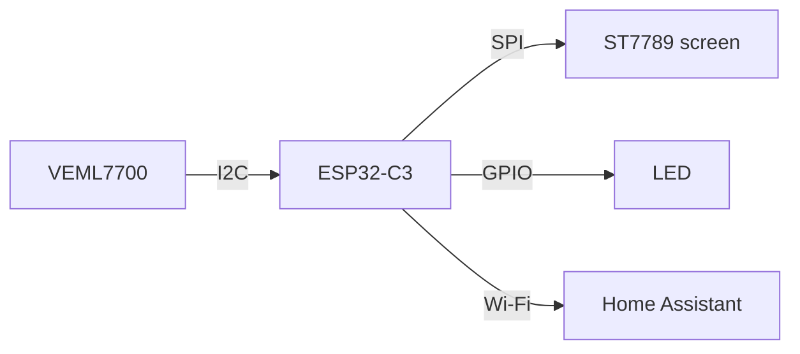
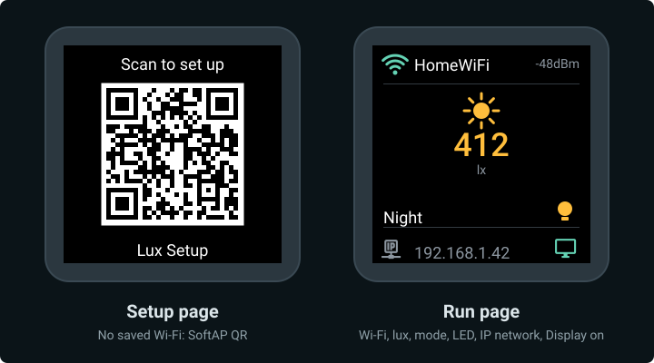

# ESP32-C3 HA lux

A small lux sensor and on/off LED that behaves like something you bought: plug it in, scan the QR code on its screen, and it shows up in Home Assistant. Mode, schedule, and night thresholds are set from Home Assistant and kept on the device.

## What you'll end up with

- :lucide-sun: **Live lux**

    Illuminance in Home Assistant and on the screen, updated every few seconds.

- :lucide-lightbulb: **Binary LED**

    On or off only, with three on-device modes: **Off**, **Schedule**, and **Night**.

- :lucide-monitor: **A live screen**

    240×240 colour display with Wi‑Fi status, lux, mode, and LED state. Turn it off from Home Assistant with **Display**.

- :lucide-qr-code: **Setup from your phone**

    Scan the code, pick your Wi‑Fi, done.

- :lucide-save: **Settings that stick**

    Mode, schedule, and night thresholds survive reboots and keep working while disconnected.

- :lucide-rotate-ccw: **Factory reset**

    Hold **BOOT** for 5 seconds to start setup again.

- :lucide-lock: **No Wi‑Fi password in the firmware**

    Not in the code and not in this repo.

## What the screen shows

*Mock-up from the firmware: SoftAP QR (no saved Wi‑Fi), then Wi‑Fi status, live lux, mode, LED state, IP, and Display-on cue. Run-page values are samples.*

## Parts

| | Part | Notes |
|---|------|-------|
| :simple-espressif: | ESP32-C3 DevKit | USB serial for flash and logs |
| :lucide-sun: | VEML7700 breakout | Ambient light over I2C at `0x10` |
| :lucide-lightbulb: | LED | GPIO-driven, on/off (GPIO6) |
| :lucide-monitor: | ST7789 240×240 display | Square 8-pin SPI module |
| :lucide-cable: | Breadboard and jumper wires | Any solderless breadboard |
| :lucide-usb: | USB **data** cable | Charge-only cables won't work |
| :brands-ubuntu:{ .lg .middle } | A computer running Ubuntu 24.04 | Builds and flashes the firmware |

Wiring is split into short steps under [Wire and validate](03-wire/index.md). The full pin map is on [Validate](03-wire/validate.md).

## Tutorial

- :lucide-file-code: **1. [Walk through the code](01-walkthrough/index.md)**

    What each block of the firmware does.

- :lucide-hammer: **2. [Build the image](02-build-image.md)**

    Install ESPHome and compile.

- :lucide-cable: **3. [Wire and validate](03-wire/index.md)**

    Breadboard, VEML7700, LED, display, then a check.

- :lucide-zap: **4. Flash the ESP32**

    Upload over USB and watch it boot.

- :brands-home-assistant:{ .lg .middle } **5. Configure and test**

    Join Wi‑Fi, add to Home Assistant, try the modes and reset.

The whole firmware is one file: [`firmware/lux.yaml`](https://github.com/jajera/esp32-c3-ha-lux/blob/main/firmware/lux.yaml).

<!-- ci: pages retrigger -->
